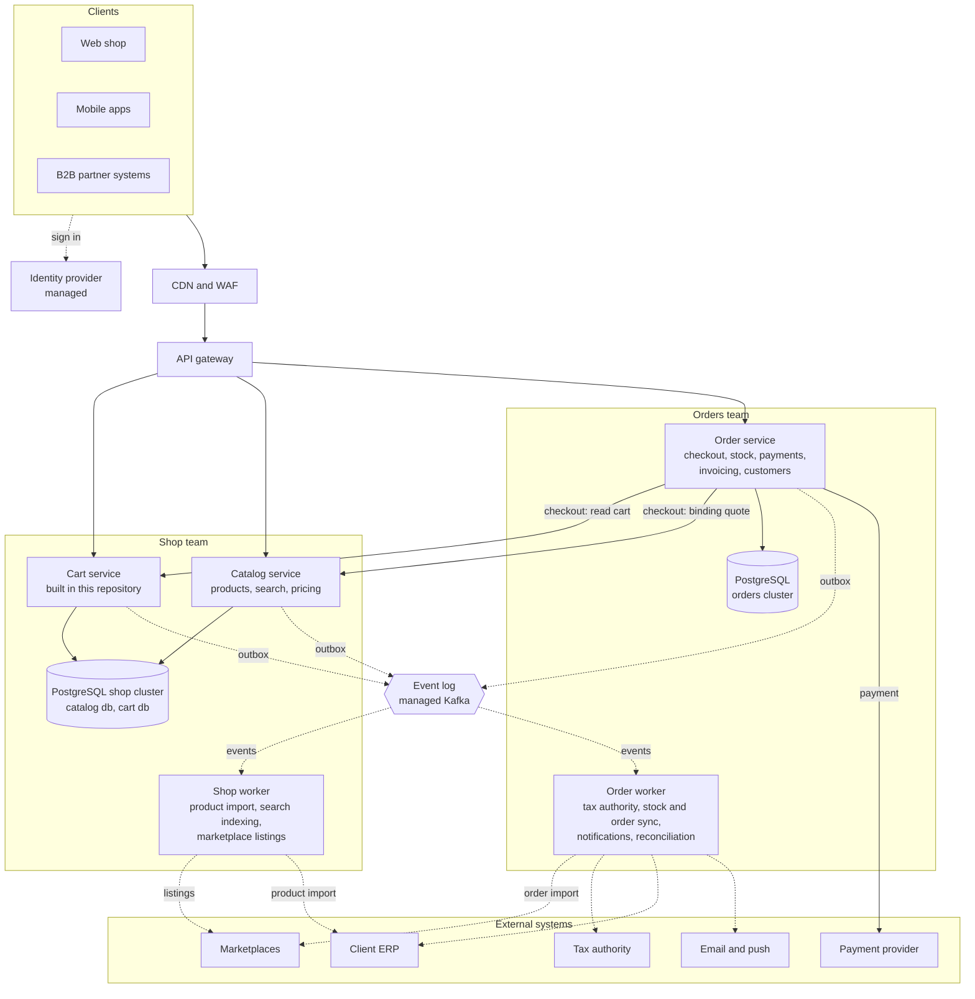
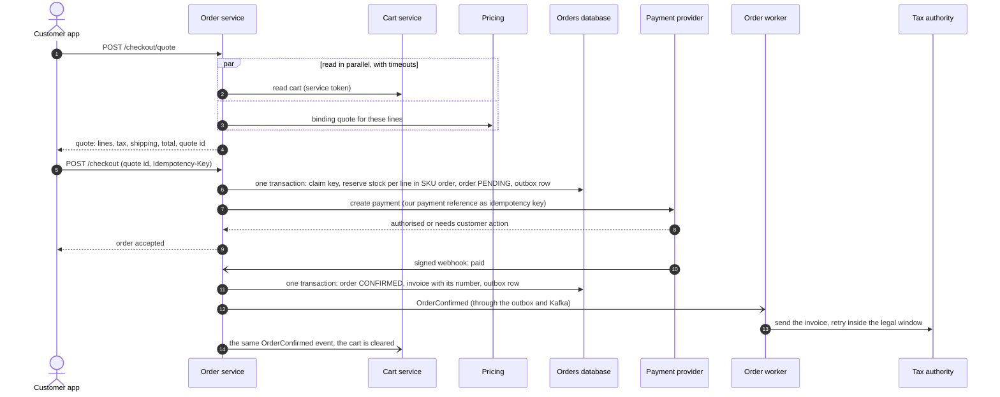

# Retail platform: architecture and delivery plan

High-level design for a global online retail platform that sells through a web shop, mobile
apps, marketplaces and B2B integrations, built and run by two cross-functional teams.

**What is real and what is a proposal.** This document describes the whole platform. This
repository implements only one part of it, the Cart API, and builds it in small steps.
[Section 11](#11-implemented-in-this-repository-versus-proposed) lists exactly what exists
today. Numbers in this document are planning estimates unless they say "measured". Nothing
here has been load-tested.

| Requirement | Section |
|---|---|
| Architectural view (high-level sketch) | [2](#2-architectural-view) |
| How components communicate | [2.2](#22-how-components-communicate), [4](#4-checkout-the-one-flow-that-crosses-services) |
| Main technology choices | [2.3](#23-technology-choices) |
| Scaling strategy | [5](#5-scaling-strategy) |
| Security and authentication | [6](#6-security-and-authentication) |
| Key components and their responsibilities | [3](#3-components-and-responsibilities) |
| Integration with external services (tax authority) | [7](#7-external-integrations) |
| Monitoring and alerting (health check) | [8](#8-monitoring-and-alerting) |
| Code delivery plan: CI/CD, branching | [9](#9-delivery-plan) |
| Implementation strategy | [10](#10-implementation-strategy) |
| Client requirement: scalability and high traffic | [1](#1-requirements-and-assumptions), [5](#5-scaling-strategy) |
| Client requirement: secure transactions and data protection | [4](#4-checkout-the-one-flow-that-crosses-services), [6](#6-security-and-authentication) |
| Client requirement: real-time data processing | [2.2](#22-how-components-communicate) |
| Four sales channels; two teams | [2.1](#21-containers), [7](#7-external-integrations); [3](#3-components-and-responsibilities), [9](#9-delivery-plan) |
| Minimal implementation of one Web API service for the cart | [11](#11-implemented-in-this-repository-versus-proposed), [README](../README.md) |

---

## 1. Requirements and assumptions

**Given:** millions of users a day on a global market; four sales channels; high
traffic; secure transactions and data protection; real-time data processing; two teams.

### Assumptions to confirm with the client

| Assumption | Value |
|---|---|
| Daily active users | 5 million, about 40 API requests each |
| Peak hour against the daily average | 5 times; campaign spikes of 10 to 30 times on single products |
| Share of requests answered by the CDN | 60% (cautious; the real figure comes from CDN logs) |
| Users who change a cart / place an order | 12% (4 changes each) / 2.5% |
| First market | One EU market; more markets later; EU personal data stays in the EU |
| System of record for products and stock on hand | The client's ERP. The platform owns what is sellable right now |
| Availability target | 99.9% for the storefront. For a lost region: recovery point under 1 minute and recovery time under 1 hour. These are targets until a failover drill proves them (phase 3) |
| Teams | Two teams of six to eight engineers who know .NET and PostgreSQL |

### What those numbers mean per second (arithmetic, not measurement)

| | Per second |
|---|---|
| Requests, daily average | about 2,300 |
| Requests at peak, at the edge | about 11,600 |
| Requests at peak that reach our services | about 4,600 |
| Cart writes at peak | about 140 |
| Orders at peak | about 7 |
| Orders in a campaign spike (30 times the peak) | about 220, most of them on a few SKUs |

The steady volume is modest. **The hard parts are spikes, hot rows, database connections and
slow third parties.**

**Not in this design:** recommendations, reviews, loyalty and gift cards; warehouse operations
(the ERP or warehouse system picks and ships); building our own identity, payment or search
engine; writes accepted in several regions at once.

---

## 2. Architectural view

### 2.1 Containers

Three services, split where the consistency needs differ, plus one background worker per team
and a gateway: six deployables.

Solid lines are synchronous calls a customer waits for. Dotted lines are asynchronous.

- The web shop is a separate front-end application served through the CDN. It and the mobile
  apps are clients of the same API.
- Marketplaces are a sales channel, but technically an integration: listings go out and orders
  come in through the workers, so they are drawn with the external systems.
- Not drawn, to keep the sketch readable: the Cart service also consumes product and price
  events to keep its own product copy, and each worker uses its service's database.

| Part | Why it is separate |
|---|---|
| **Browse** (Catalog) | Read-heavy and may be seconds stale. Served from the CDN and the search engine, so most traffic never reaches a database |
| **Cart** | Per-user writes with low stakes. Carts of different users never contend. It keeps its own copy of product names and prices and calls nobody when a shopper adds an item |
| **Money** (Order) | Low volume, must be exact. Order, stock, payment and invoice state share one database, so reserving stock and creating the order is one local transaction. No distributed transaction where money moves |
| **After commit** (workers) | Tax authority, ERP, marketplaces and email are slow or external. They run after the customer has their answer |

Cart as its own deployable is the weakest of these boundaries: the same team owns Catalog. It
is kept so carts stay writable through catalog deployments and failures, and it is merged back
into Catalog if the two always release together.

### 2.2 How components communicate

| Kind | Where | Rules |
|---|---|---|
| Client to platform | REST and JSON over HTTPS through the gateway | Versioned in the path (`/api/v1`), additive changes only, errors as Problem Details (RFC 9457), OpenAPI published |
| Service to service, synchronous | **Only at checkout**: Order calls Cart (read the cart) and Pricing (binding quote) | One direction, in parallel, with timeouts. Nothing in the shop calls the Order service, so a slow checkout cannot back up into browsing or carts |
| Service to service, asynchronous | Everything else | Transactional outbox, then Kafka, then consumers |
| Platform to third parties | Payment in the request path; all others from workers | See [section 7](#7-external-integrations) |

### Event rules

- The event row is written in the same database transaction as the state change (transactional
  outbox). A relay publishes it. A change without its event, or the reverse, cannot exist.
- The relay retries a failing publish indefinitely with capped backoff, and an alert fires on
  the age of the oldest unpublished row. A broker outage delays events; it never drops them.
- Each service's API process hosts its own outbox relay and its event consumers as background
  services, so there is no extra deployable. All replicas run the relay loop, but only one is
  active per database at a time: it holds a transaction-scoped advisory lock while it
  publishes a batch.
- Delivery is at least once. A consumer that writes to its own database records the processed
  event id in the same transaction as its work, so a duplicate is ignored. A consumer whose
  effect is outside a database (search index, marketplace push, email) relies on an idempotent
  write keyed by id and version, or on the provider's idempotency key.
- Order is guaranteed **per aggregate** (per cart, per order, per SKU), not globally: one
  aggregate's writes are serialised, so its outbox rows are in order; one active relay
  publishes them in that order; and the topic is keyed by the aggregate id.
- Events carry the full new state of their aggregate and a version. A consumer keeps the
  highest version and never needs the previous event or a call back to the owner. People are
  referenced by id: no event carries a name, an address or contact details.
- An event a consumer cannot process at all (a poison message) goes to a dead-letter topic and
  opens a ticket. That is different from work we own that must eventually succeed, such as
  sending an invoice: that is a job row with retries, described in section 7.
- State topics are compacted, so a new consumer builds its copy by reading them. Topics that
  hold personal data (cart state) also have a time limit equal to that data's retention.

"Real-time" is read as: the customer gets a synchronous answer for what they are
waiting on, and price, stock and order status reach every channel within seconds. Target: 99%
of events consumed within 5 seconds.

### 2.3 Technology choices

| Concern | Choice | Alternative considered | What would change the choice |
|---|---|---|---|
| Language and framework | .NET 10 (LTS), ASP.NET Core, EF Core | Any mainstream stack; chosen because both teams know it (assumption) | A team with a different skill set |
| Database | PostgreSQL, one database per service, two managed clusters (shop, orders) | Redis or DynamoDB for carts; a document store for the catalog | Tens of thousands of cart writes per second would call for a key-value store for carts |
| Event log | Managed Kafka | RabbitMQ or a cloud queue | Chosen for three needs: many independent consumers of one event, order per key, and compacted topics to rebuild copies. If those are not real, a simpler managed queue. Publishing sits behind the outbox and one interface, so the swap is contained |
| Long-running retries (tax authority, ERP, email) | The job is a row in the owner's database with status and next attempt; an event only wakes the worker | A queue product with delayed delivery | Many job types with complex routing |
| Gateway | YARP on containers: routing, token check, CORS | Cloud API management | Dozens of partners needing a developer portal |
| Edge | CDN and WAF, bought (for example Cloudflare, Azure Front Door, CloudFront) | None | None |
| Identity | Managed OpenID Connect provider (for example Entra External ID, Auth0, Cognito) | Self-hosted Keycloak | The per-user quote exceeds the cost of running it |
| Search | Managed search engine (OpenSearch or Elasticsearch) fed from product events. **Assumption**: large catalog, filters, several languages | PostgreSQL full-text | A small catalog with name search only: start on PostgreSQL full-text |
| Cache | CDN first, in-process cache second | Redis from day one | A few products dominating database reads, or a need for shared rate-limit counters: add Redis |
| Compute | Phase 1: a managed container service (for example Azure Container Apps, ECS, Cloud Run). Phase 3: managed Kubernetes | Kubernetes from day one | Several regions, more than about ten deployables, or an existing platform team |
| Payments | One payment provider with hosted card fields (for example Adyen or Stripe); a second provider in phase 3 | None | None |
| Telemetry | OpenTelemetry; the backend is bought (for example Grafana stack, Datadog, Azure Monitor) | Vendor agents | None |

The cloud provider is the client's decision and nothing above depends on one: every bought
part is named by what it does, with examples.

---

## 3. Components and responsibilities

One owner per capability. The owner is the only writer of that data. Everyone else gets it
through an API or as a copy fed by events, and a copy is never treated as the truth.

| Capability | Runs in | Team | Database |
|---|---|---|---|
| Products, categories, search | Catalog service | Shop | catalog |
| Price lists per market, promotions, tax calculation, the binding quote | Catalog service (Pricing module) | Shop | catalog |
| Carts; the consumers that keep the cart's product copy fresh and clear a cart after an order | Cart service | Shop | cart |
| Product and price import from the ERP, search indexing, marketplace listings (prices and stock pushed out) | Shop worker | Shop | catalog |
| Storefront screens: browse, search, cart (web and mobile) | Client apps | Shop | none |
| Checkout, order lifecycle, cancellations, returns, refunds | Order service | Orders | orders |
| Sellable stock and reservations | Order service | Orders | orders |
| Payment state and reconciliation | Order service | Orders | orders |
| Invoices, numbering, fiscal status | Order service (create), Order worker (send) | Orders | orders |
| Customer profile, addresses, consent, B2B company accounts | Order service | Orders | orders |
| Email and push notifications | Order worker | Orders | orders |
| Marketplace and B2B order import; stock, orders and refunds exchanged with the ERP; tax authority | Order worker | Orders | orders |
| Checkout, account and back-office screens | Client apps | Orders | none |
| Routing, token check, CORS, guest tokens | API gateway | Shop runs it; each team owns its own routes | none |
| Login, tokens, staff single sign-on | Identity provider (bought) | Shared | its own |
| Event log, infrastructure code, pipeline templates | Managed Kafka, the platform repository | Shared, with one named platform owner per sprint, rotating between the teams | none |
| Reporting | Data warehouse fed from Kafka (bought) | Shared | its own |

Modules inside one service may share a database, each in its own schema, and may not read each
other's tables. A worker is a second process of the service that owns the data it touches.

**The Cart service in the platform.** The cart is resolved from the access token, so there is
no cart id in any public URL and another user's cart cannot be addressed. Product names and
prices come from the service's own `products` table. In the platform that table is keyed by
SKU and market and fed from Catalog and Pricing events; the implementation in this repository
uses demo data for a single market instead. A cart line's price is a display snapshot; the binding price is computed at checkout.
Checkout reads a cart through an internal endpoint that needs a service token and is not
routed by the gateway.

---

## 4. Checkout: the one flow that crosses services

- The customer confirms a **quote**, not the cart total. The cart total has no tax, shipping
  or promotions, so comparing against it would fail whenever any of those apply.
- Not charging twice: the idempotency key is claimed by insert inside the order transaction,
  and live orders are unique on (user, cart id, cart version). The second rule covers an app
  that crashes after paying and retries with a new key.
- Not selling twice: stock is reserved by one conditional update per line. Lines are processed
  in SKU order, so two orders cannot deadlock. Reservations expire.
- The payment provider is never called inside a database transaction. The order is saved as
  PENDING with a payment reference we generate, and that reference is sent to the provider as
  its merchant reference and idempotency key; the provider's own id is stored when it answers.
  The result is confirmed by a signed webhook. A reconciliation job asks the provider, by our
  reference, about anything pending too long, so a crash between the commit and the call
  loses nothing.
- The cart is cleared when the order is confirmed, not when it is placed, so a failed payment
  leaves the cart as it was.
- The invoice row is created in the confirming transaction. Only sending it to the tax
  authority is asynchronous.

---

## 5. Scaling strategy

Every API is stateless and scales by replica count. The first real ceiling is database
connections: without a pooler, replicas times pool size must stay under the database's connection
limit, which caps autoscaling. PgBouncer in transaction mode lifts that cap; pools stay small
(about 20 per replica) all the same. Transaction mode is also why the cart's write lock is
transaction-scoped (`pg_advisory_xact_lock`) and not session-scoped.

A ladder. Steps 1 to 3 exist on day one. The rest are climbed when the named metric fires.

| # | Step | Trigger | What it buys |
|---|---|---|---|
| 1 | Cache at the edge | Day one | Most product and category reads cost no compute |
| 2 | Autoscale stateless replicas, minimum three across zones | Day one; CPU over 60%, or consumer lag for workers | Linear capacity for APIs and workers |
| 3 | Connection pooling and query tuning | Day one; revisit when pool wait time is above zero | Headroom from the same database |
| 4 | Read replicas | Primary CPU over 60% from reads | Catalog and reporting reads leave the primary. Never where a user reads their own write |
| 5 | Redis | The same few products dominate reads; shared rate-limit counters needed | Hot keys in memory, shared counters |
| 6 | Bigger primary; partition append-only tables | Write latency rising; tables over about 100 GB | A larger instance is the cheapest next step for a write-bound primary; partitions keep indexes small |
| 7 | Shed and shape load | Announced campaigns; traffic over tested capacity | Waiting room, per-client limits; the shop stays up for people already inside |
| 8 | A full stack per market ("cell") | Latency for distant users, residency law, one primary at its limit | Each region gets its own services and data |
| 9 | Shard carts by a hash of the user id | Cart writes beyond one primary | Carts are independent per user, so they shard cleanly |

**Likeliest bottleneck: the Order service's PostgreSQL primary.** Connections go first, then row
locks on popular products during a campaign. It shows up as rising checkout latency while API
CPU stays low. Seven orders a second is nothing for PostgreSQL; a campaign that puts about
220 orders a second on a few stock rows is the case to design for. Prevention: pooling, the
SKU-ordered conditional stock update, no third-party call inside a transaction, a waiting room
and rate limits at the edge for announced sales, and client retries with backoff and the same
idempotency key. The invoice-number counter is the next hot row, because it is taken in the
confirming transaction; several logical billing devices per region spread it.

**Global market.** One write region at launch; reads are global through the CDN. Never one
database written from several regions.

| Global | Per region (cell) |
|---|---|
| Product master, price-list definitions | Customer accounts (an identity tenant per region), carts, orders, customer data |
| | One stock ledger per fulfilment region, never one counter written from two regions |
| | Invoices, with a number series per region so a failover cannot reuse a fiscal number |

**Availability baseline.** Every tier in three zones; PostgreSQL with a synchronous standby;
an asynchronous copy of each database in a second region from phase 1. Losing a region is the
one event allowed to exceed the error budget.

**Proof.** A load test that mixes browse, search, cart and checkout, run at 1, 2 and 5 times the
expected peak before launch and before campaigns. Until that test passes, the capacity figures
in this document are estimates.

---

## 6. Security and authentication

### Authentication

- Login is never built in-house. OpenID Connect: web and mobile use Authorization Code with
  PKCE; B2B partners use client credentials; staff use single sign-on with MFA. Guests get a
  signed guest token from a small endpoint of our own, so the cart works before login.
- Access tokens are JWTs signed with RS256 or ES256 that live 5 to 15 minutes. Every service
  validates them locally with pinned algorithms, issuer and audience. Refresh tokens rotate.
  Validation scales with our replicas and needs no call to the provider; the price is that a
  token cannot be revoked instantly.

### Authorisation

- Identity comes from the token, never from the URL or body. A shopper's queries filter on the
  user id; a partner's on the organisation id; staff routes need a role.
- Service-to-service calls use short-lived service tokens with scopes on a private network.
  Kafka has per-topic access lists.

### Trust boundaries

| Boundary | What the other side could try | Control |
|---|---|---|
| Internet to edge | Flooding, scraping, password guessing, testing stolen cards | WAF and bot rules, per-IP limits at the CDN; lockout and MFA at the identity provider |
| Shopper to API | Reading or changing someone else's cart or order; replaying a request; holding stock without paying | Identity from the token on every query; idempotency keys; caps on pending reservations |
| Partner to API | Reading another company's prices or orders; flooding | Organisation claim on every query; per-partner quotas |
| Webhook sender to platform | Forged or replayed events | Signature and timestamp check; duplicate stopped by a unique key; state machine accepts only valid transitions |
| Staff to back office | Misuse, stolen account | Single sign-on with MFA, roles, append-only audit log |

**Rate limiting** has three layers: per IP and bot rules at the CDN from day one; per user and
per partner at the gateway (per replica until Redis provides shared counters); a per-replica
guard in each service.

### Data protection

- Card data never reaches our servers. The payment provider's hosted fields return a token,
  which keeps PCI DSS scope at the smallest self-assessment level, and the provider's flow
  handles strong customer authentication (3-D Secure).
- A customer's profile lives in one place (Customers), and events reference people by id. An
  order and its invoice keep an immutable copy of the buyer's name and address as issued,
  because the law requires it. Every store has a retention period: carts 30 days after the
  last change, orders and invoices for the statutory period, logs 30 days. EU personal data
  stays in the EU cell.
- Encryption in transit and at rest. Secrets in a secret manager with workload identity;
  nothing in the repository or in images.
- Validation in three places: at the boundary (explicit request types, sizes, formats), in the
  domain (business rules), in the database (constraints that hold even if code is wrong).
  Prices are always looked up on the server.
- Supply chain: centrally pinned dependency versions, a vulnerability audit and secret
  scanning in CI, build actions and base images pinned by digest, least-privilege deploy
  credentials.

---

## 7. External integrations

**One rule:** a third party is never in the customer's request path unless the customer is
waiting for exactly that answer. Only payment qualifies. Any other third party's outage
degrades one feature and never the shop.

### Tax authority (Porezna uprava): the worked example

1. The Order service creates the invoice in the confirming transaction, with its sequential
   number and the locally computed protective code (ZKI), and commits it.
2. Only then does the Order worker send the signed request. The authority's identifier (JIR)
   is stored when it returns.
3. If the authority cannot be reached, the receipt is still valid with the local code. The
   invoice row carries status, attempts and next attempt time, and the worker retries inside
   the legal window (two days under the rules in force before 2026; to confirm). An alert
   fires at half the window.

On Black Friday with the authority down, checkout is unaffected and the backlog drains later.
Invoice numbers come from a row-locked counter per premises and device; business customers get
a structured e-invoice through an intermediary. Each country is one adapter behind one
interface.

> To confirm with the client's accountant before treating as fact: the Croatian rules changed
> in 2026 (Fiscalisation 2.0, mandatory domestic B2B e-invoicing). The shape above (commit,
> then send, with durable retry) does not depend on those details.

### Every other integration follows one adapter pattern

| Direction | Pattern |
|---|---|
| Inbound (webhooks) | Verify the signature, store the raw payload keyed by the sender's id, answer 200, process asynchronously. A duplicate hits the unique key and stops |
| Outbound | Consume the event, create or update the job row, call with a timeout, retry with backoff and jitter behind a circuit breaker. After repeated failure the job is marked failed and alerts; nothing is dropped |
| Reconcile | A scheduled job compares our state with theirs (payments, marketplace orders, stock) and repairs drift |
| Translate | The adapter maps their model to ours; their field names never appear in domain code |

- **Payments:** see [section 4](#4-checkout-the-one-flow-that-crosses-services).
- **ERP:** the Shop worker imports the product master and prices into Catalog; the Order
  worker imports stock on hand and sends orders and refunds. Phase 1 needs at least a minimal
  import and a refund tool, or the shop cannot open.
- **Marketplaces:** same Order service, same stock ledger, same price authority; a stock
  safety buffer per marketplace. Who is the seller of record on a marketplace order decides
  VAT and fiscalisation, and is a question for the client.
- **B2B:** organisation-scoped tokens, contract price lists resolved by Pricing, payment on
  account instead of by card, bulk orders accepted with 202 and a status link.

---

## 8. Monitoring and alerting

OpenTelemetry in every service. Traces, metrics and logs share a trace id that travels in HTTP
headers and Kafka message headers.

### Service level objectives, over 28 days

| Indicator | Target |
|---|---|
| Storefront availability, measured at the CDN plus an outside probe that browses, fills a cart and checks out in sandbox | 99.9% |
| Cart latency, server time | p95 under 150 ms, p99 under 400 ms |
| Checkout success, out of attempts that passed validation (declines and out-of-stock are not failures) | 99.5% |
| Event freshness, commit to consumed | 99% within 5 s |
| Fiscalisation | 99% of invoices registered within 5 minutes. The legal window is a hard limit, not an objective, and has its own alert |

**Alerting.** Pages are for symptoms a customer feels or a deadline about to pass. Causes open
tickets. Every alert has a duration and a runbook.

| Pages someone | Opens a ticket |
|---|---|
| Error budget burning fast (2% of the 28-day budget in one hour) | Error budget burning slowly (10% in three days) |
| Outside probe failing from two locations | Database connections over 80% of the limit; replication lag |
| Orders per minute down more than half against last week | Any message in a dead-letter topic |
| Oldest unpublished outbox row or unconsumed critical event older than two minutes | Certificate expiry within 30 days |
| Oldest unfiscalised invoice older than half the legal window | Cache hit ratio trending down; slow queries |

### Health checks

| Endpoint | Meaning | Orchestrator reaction |
|---|---|---|
| `/health/live` | The process responds. No dependencies | Restart when failing |
| `/health/ready` | The database answers within a short timeout | Stop routing traffic when failing; never restart |

A failing third party does not make a replica unready; circuit breakers and alerts handle
that. When the database is down every replica is unready together, which is accurate. Workers
and the outbox relay loops have no traffic to stop, so they report a heartbeat metric: the
time of their last completed loop, whether or not it had work. An alert watches it.

---

## 9. Delivery plan

### Repository and branching

- One repository for the platform, one folder per service, code owners per folder, pipelines
  triggered by path. A contract change lands with both sides in one pull request.
- Trunk-based: `main` is protected and always deployable. Branches live at most two days.
  One review from the owning team, all checks green, squash merge, Conventional Commits.
- Unfinished work ships dark behind a feature flag. A release is a tag on `main`; a hotfix is
  the same flow with a small change. No long-lived `develop` or release branches.
- Mobile apps are the exception: customers install them, so they use release branches and tags.

### CI/CD

| Stage | Steps |
|---|---|
| Pull request | In this order: restore, build with warnings as errors, format check, unit tests, integration tests on a real PostgreSQL, contract check, vulnerability audit, image build |
| `main` | Build the image once and tag it with the commit. Deploy to dev and run smoke tests. Deploy to staging and run end-to-end tests and a short load test. Release to production as a rolling update, rolling back automatically on failed health checks or an objective breach |

- The same image moves through every environment. Configuration comes from the environment.
- Rollback: code rolls back, the schema only moves forward. Schema changes expand first
  (add the new shape, deploy code that handles both) and contract one release later.
  Migrations run as their own step before the rollout and must work with the previous version
  of the code.
- Infrastructure is code, reviewed like any other change.

### Teams

- Shop team: Catalog service, Cart service, Shop worker, storefront screens.
- Orders team: Order service, Order worker, checkout and back-office screens.
- Shared: event schemas (changes reviewed by both teams), pipeline templates, infrastructure
  code, dashboards. One named platform owner per sprint, rotating between the teams.
- On call: each team covers its services in working hours; out of hours is one shared rota
  paged only by the symptom alerts above.

---

## 10. Implementation strategy

A thin slice through every layer before any layer is made deep.

| Phase | Scope | Exit criteria |
|---|---|---|
| 1: First market | Gateway, identity provider, Catalog with search, Cart, Order with one payment provider, outbox and Kafka, fiscalisation, email, minimal product and stock import, refund tool; three zones and a cross-region database copy | A real order placed end to end in production; load test passes at twice the expected peak; checkout objective met for two weeks |
| 2: Integrations and reach | Full ERP sync, marketplace listings and order import, partner API with bulk orders and payment on account, back office; Redis and read replicas if their trigger has fired | Stock agrees with the ERP in daily reconciliation; one marketplace and one partner live |
| 3: Global | A second cell for the next region, tax adapters per country, a second payment provider, managed Kubernetes | A market is added by configuration and one adapter; a region can be lost and recovered inside the targets, proven by a drill |

In phase 1 the Shop team builds browse and cart while the Orders team builds checkout and
payment against agreed API and event contracts. They meet at the first end-to-end order.

### When something is down

| Down | The customer sees | What is lost |
|---|---|---|
| One API replica | Nothing | Nothing |
| PostgreSQL primary | Errors until the standby is promoted (duration to be measured in a failover drill) | Nothing committed |
| Kafka | Nothing while shopping; search, cart product copies and marketplaces go stale | Freshness only; events wait in each outbox |
| Payment provider | Checkout fails fast with a clear message; browsing and carts work | Sales during the outage |
| Tax authority | Nothing | Nothing; sending resumes inside the legal window |
| Identity provider | Signed-in users keep working until their access token expires (5 to 15 minutes), then cannot refresh; new logins fail | Sessions that need a refresh, and new logins, during the outage |
| Cart service | Cart unavailable; browsing works; checkout fails fast | Nothing; carts are in the database |
| Catalog service | Cached product and category pages keep working; search, uncached pages and checkout (no quote) fail | Sales during the outage |
| Order service | Browsing and carts work; checkout and order history fail | Sales during the outage |
| A whole region | Outage until the second-region copy is promoted | Up to the recovery point of writes, repaired by payment and invoice reconciliation |

---

## 11. Implemented in this repository versus proposed

This repository holds a minimal implementation of one Web API service, the cart, with a
database and some of the requirements above. This table is kept in step with the code.

### Cart service

| Capability | Status |
|---|---|
| Solution skeleton, liveness endpoint (`/health/live`), structured JSON logs | Implemented |
| CI workflow: build with warnings as errors, format check | Implemented; not yet run on GitHub |
| Cart rules: quantity and line limits, one currency per cart, price snapshot | Planned in this repository |
| PostgreSQL persistence with EF Core migrations; readiness endpoint (`/health/ready`) | Planned in this repository |
| Dockerfile and Docker Compose: database, migrations, demo data, API | Planned in this repository |
| JWT bearer authentication; development-only token endpoint; cart resolved from the token | Planned in this repository |
| Four cart endpoints with validation and Problem Details errors | Planned in this repository |
| Safe concurrent updates: writes on one cart serialised by a database lock | Planned in this repository |
| Unit tests and integration tests on a real PostgreSQL | Planned in this repository |
| Outbox and `cart.changed` events; the consumers that feed `products` and clear a cart after an order | Proposed only |
| Internal cart read for checkout; guest carts and merge at login; cart expiry | Proposed only |
| Rate limiting, OpenTelemetry traces and metrics | Proposed only |

**Everything else in this document is proposed only:** the Catalog and Order services, both
workers, the gateway, Kafka, Redis, the search engine, the identity provider integration,
payments, the tax authority and other adapters, the deployment platform, dashboards and
alerts. "Real-time processing" in particular is design only: this repository publishes no
events.
